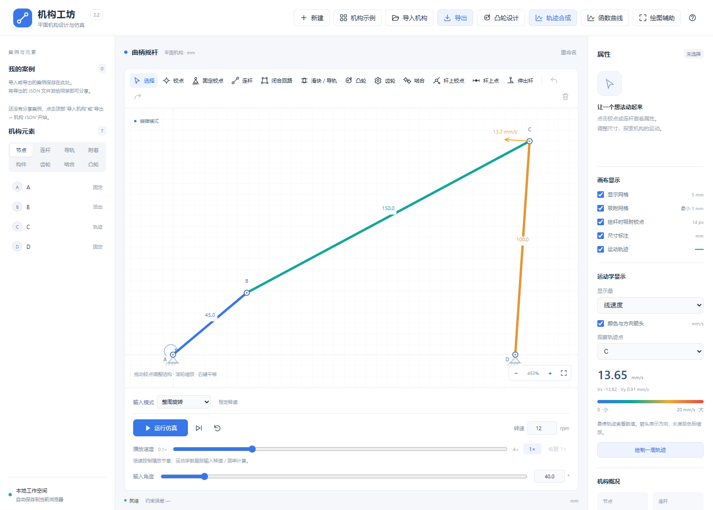

# 机构工坊 · JiGou Workshop 2.2

**从绘制与搭建，到凸轮设计、轨迹逆向合成和 CAD 几何导出。**

机构工坊是一个中文、离线运行的平面机构设计与运动仿真工具，适合机械原理学习、课堂演示和机构方案探索。在浏览器中搭建连杆、导轨、齿轮及凸轮，观察运动和轨迹，也可以从已有或手绘目标轨迹搜索候选机构。

软件采用独立实现的几何求交与数值约束求解器。运行所需的 HTML、CSS 和 JavaScript 可以打包为单个离线文件，不依赖后端、联网资源或第三方运行库。源码以 MIT 许可证公开。

An offline, browser-based planar mechanism editor and kinematic simulator with a Chinese interface, cam design, trajectory synthesis, and DXF export.



## 功能概览

| 功能 | 可以做什么 |
| --- | --- |
| 绘制与搭建 | 创建铰点、固定支点、连杆、闭合铰接回路、整体刚性构件和固定 / 活动导轨 |
| 齿轮与轮系 | 外啮合、内啮合、蜗杆简图、复合定轴及行星传动，查看传动比与角速度 |
| 凸轮设计 | 独立窗口设计直动 / 摆动从动件，修改运动规律与安装参数，或手绘轮廓 |
| 轨迹逆向合成 | 从已有轨迹或手绘目标比较四杆、曲柄滑块、齿轮联动五杆和行星齿轮候选 |
| 运动分析 | 观察位置、速度、加速度与角速度，比较多节点 X–Y、分速度及完整周期曲线 |
| 绘图辅助与导出 | 底图两点比例标定、动态距离 / 角度测量，导出机构 JSON、PDF、CSV 与毫米 DXF |

附带 **22 个内置示例、35 份可导入机构、6 份目标轨迹**和 **20 页使用说明书与案例教程**。

## 下载与快速开始

1. 点击仓库顶部 **Code → Download ZIP**，解压完整项目；也可使用 `git clone https://github.com/HollandBC/jigou-workshop.git`。
2. 用 Edge 或 Chrome 打开 `机构工坊_离线版.html`。运行软件不需要安装 Node.js，也不需要启动服务器。
3. 先选择“机构示例 → 曲柄摇杆”，点击“运行仿真”；再尝试顶部“凸轮设计”“轨迹合成”与“绘图辅助”。
4. 从“使用帮助”打开 [网页版说明书](docs/机构工坊_使用说明书_2.2.html)，或阅读 [PDF 教程](output/pdf/机构工坊_使用说明书与案例教程_2.2.pdf)。

推荐保留完整目录，方便读取说明书和附赠案例；单独复制离线 HTML 也能运行主体功能。

## 项目目录与开发

| 路径 | 内容 |
| --- | --- |
| `src/` | 几何、模型、约束求解、运动学、绘图、凸轮、轨迹合成及导出源码 |
| `examples/` | 可导入机构、目标轨迹和四杆教学参考底图 |
| `docs/` | 使用说明、开发说明、版本交接、截图及验证记录 |
| `output/` | PDF、CSV 和 DXF 示例输出 |
| `tests/` | 150 项 Node.js 几何、运动学、分享与导出检查 |
| `tools/` | 离线版构建、预览服务、案例校验与隔离浏览器检查工具 |

开发和自动检查使用 Node.js 24：

```sh
npm test
npm run build
node tools/verify-release.cjs
npm start
```

上述 Node.js 测试与构建无需安装 npm 依赖。浏览器检查工具需要另行提供 Playwright 和 Edge；PDF 手册生成工具需要 Python、ReportLab 及相应字体。

软件用于平面几何和运动学设计。轨迹合成搜索有限拓扑并报告采样偏差，不保证任意目标精确匹配；DXF 输出静态几何与齿轮节圆，工程制造仍需完成尺寸、受力、干涉与工艺设计。保存可继续编辑的机构时，请使用机构 JSON。

许可证：[MIT](LICENSE)。

## 打开与使用

双击 `机构工坊_离线版.html` 即可使用，该文件已包含所有样式和代码，可以单独复制到其他电脑。也可双击 `index.html` 或 `启动机构工坊.cmd` 使用分文件源码版本。推荐使用已安装的 Edge 或 Chrome。无需安装 Node.js，无需联网，不加载在线字体、资源或第三方库。

首次打开显示曲柄摇杆。点击“运行仿真”，观察运动；选择铰点或连杆可在右侧修改属性。点击“使用帮助”查看绘图步骤与快捷键。

点击顶部“机构示例”按钮，弹出 22 个案例：曲柄摇杆、双曲柄、双摇杆、曲柄滑块、转动导杆、移动导杆、曲柄摇块、正弦机构、双滑块、双转块、位移缩放、多杆轨迹、杆上点与伸出杆、Jansen 行走机构，外啮合、内啮合、阿基米德圆柱蜗杆传动、复合定轴轮系、行星轮系、齿轮连杆扑翼机，以及直动 / 摆动从动件平面凸轮机构。选择后窗口自动关闭；也可按 Esc、点击关闭按钮或窗口外侧退出。手机界面显示为“示例”按钮。

## 2.2 底图、动态测量与 CAD 导出

参考 [Linkage 官方手册](https://www.rectorsquid.com/Linkage.pdf)，补充从图纸复建到 CAD 交接的流程。详细 [功能对比与选择依据](docs/Linkage功能对比与2.2补充.md)。

- 顶部“绘图辅助”：导入 PNG/JPEG/WebP，点选已知距离的两个端点标定毫米比例，调整中心、旋转与不透明度。底图随 JSON 文件及自动保存携带，可隐藏、移除和撤销。
- 同一窗口添加两点距离或三点小角测量，支持节点、杆上点与伸出端；数值随实际运动更新，不增加自由度。测量可隐藏或删除，关联点删除后自动清理，撤销可恢复。
- “导出 → CAD 几何 DXF”：毫米坐标 R2000，输出当前杆件、导轨、凸轮闭合轮廓、齿轮节圆、可见测量及开启的轨迹，按图层编辑。画布缩放不改变坐标比例。

机构结构保持 **v9**，普通案例设置 v1；带底图和测量的文件使用 **案例设置 v2**，需要 2.2 或更新版。22 个内置案例，examples/ 有 **35 份机构、6 份目标轨迹**及四杆参考底图。新教学案例为“绘图辅助_底图标定与动态测量.机构.json”，附 output/教学四杆_毫米几何_2.2.dxf。

新版说明书 **14 章、20 页**：[离线可搜索 HTML](docs/机构工坊_使用说明书_2.2.html) · [可打印 PDF](output/pdf/机构工坊_使用说明书与案例教程_2.2.pdf) · [开发交接](docs/开发交接_2.2.md)。第 14 章说明底图标定、复建、动态测量和 DXF；软件帮助有入口。

**150 项 Node.js 检查、13 组软件浏览器检查及 1 组手册浏览器检查**通过，35 份机构完整周期与分享往返通过。8 份 DXF 用独立 ezdxf 读取审计，毫米单位、零错误 / 零修复。软件仍为无外部依赖的离线 HTML（18 个内嵌脚本）。

底图等比标定不处理透视；DXF 为静态几何，齿轮是节圆，杆件是中心线，不包含加工外形或机构运动约束。继续编辑和运行应使用机构 JSON。

## 2.1 新增候选与完整使用说明书（历史基础）

轨迹合成增加 **齿轮联动五杆** 和 **行星齿轮轨迹机构**，与四杆、曲柄滑块一起自动比较。五杆通过同步外啮合约束两曲柄，保持单输入；行星采用固定内齿圈和偏心点，可拟合椭圆、花瓣和多环轨迹。候选显示齿数、尺寸顺序及周期所需输入圈数；固定支点支持四杆与五杆。行星完整周期可能需 1～3 输入圈，预览、仿真和导出均保留完整回位。

本版保存 **v9** 机构文件，兼容 v1～v8；新增类型文件请用 2.1 或更新版。22 个内置示例保留，examples/ 增至 **34 份**机构，含三份新齿轮合成与两份按教程尺寸搭建的案例；examples/轨迹目标/ 有 **6 份**独立目标。

[使用说明书网页版](docs/机构工坊_使用说明书_2.1.html) · [可打印 PDF](output/pdf/机构工坊_使用说明书与案例教程_2.1.pdf) · [说明书源码](docs/机构工坊_使用说明书_2.1.md)。共 13 章、17 页，覆盖从零搭建四杆 / 曲柄滑块、导轨、齿轮、参数与手绘凸轮、四类轨迹合成、曲线、文件分享、案例导航和常见问题。网页版的样式与图片内嵌，支持搜索、目录跳转及手机阅读；软件“使用帮助”中有入口。

[五杆候选](docs/界面预览_合成五杆_候选_2.1.png) · [两圈行星候选](docs/界面预览_合成行星_两圈候选_2.1.png) · [开发交接](docs/开发交接_2.1.md)。143 项 Node.js 检查、12 组软件浏览器检查及一组说明书浏览器检查通过。新增齿数配对为离散集合；不计算碰撞、制造齿形或承载。

## 2.0 从目标轨迹生成机构（基础功能）

点击顶部“轨迹合成”（手机显示“合成”），进入独立的逆向设计窗口。2.0 首批支持 **四杆机构和曲柄滑块**，自动模式同时搜索两类结构，最多显示六个可运行候选。

1. **准备目标**：在画布选择节点后打开窗口，选择铰点、杆上点或伸出端，点击“提取机构轨迹”。也可清空后手绘一笔，拖动控制点、平滑、撤销修改，或导入目标轨迹 JSON。轨迹坐标和尺寸采用 mm；修改轨迹宽度会等比例缩放。附四杆、椭圆和开放直线练习目标。
2. **设置搜索**：选择机构类型、杆长上下限、目标 RMS 和快速 / 标准 / 深入搜索。可允许反向匹配；四杆可输入或在预览中点选两个固定支点，求解保持其位置。闭合目标生成整周回转机构，开放目标生成沿目标去程、原路返回的区间摆动机构。
3. **比较方案**：搜索显示进度，可随时取消并保留已有候选。每个方案显示 RMS、最大采样偏差、杆长、匹配方向及完整运动检查结果。橙色虚线为目标，蓝线为候选的实际几何轨迹；可显示误差连线，拖动输入相位或播放预览。
4. **继续设计**：应用候选后生成真实单输入机构，可以仿真、编辑尺寸、观察速度 / 加速度、画函数曲线和保存分享。画布保留橙色目标对照，支持撤销 / 重做；保存重开后再次进入合成窗口，可恢复目标与搜索设置并继续求解。

窗口可导出 **目标轨迹 JSON、候选机构 JSON、采样偏差 CSV 和 A4 对比 PDF**。examples/ 共 29 份可导入机构，其中新增四杆拟合、手绘椭圆曲柄滑块、开放直线合成三例；examples/轨迹目标/ 另附三份目标文件，需在“轨迹合成”窗口导入。顶部仍有 22 个内置示例。

2.0 发布时保存 **v8** 机构文件，兼容读取 v1～v7；带目标与合成设置的 v8 文件请用 2.0 或更新版。目标文件使用独立的 `jigou-trajectory` v1 格式，不是机构文件。

逆向求解按目标的弧长和顺序拟合形状，不指定经过每一点的时间。RMS 与最大偏差来自离散采样，未达到目标 RMS 时会明确标注。复杂手绘曲线可能只能近似，深入搜索也不保证全局最优；2.1 扩展至四类，仍不自动生成六杆等其他拓扑。候选必须通过实际约束求解器的完整周期采样和单自由度检查，应用后的运动由杆长、铰点和导轨决定。

[查看合成窗口](docs/界面预览_轨迹合成_四杆候选_2.0.png) · [手绘目标求解](docs/界面预览_轨迹合成_手绘椭圆_2.0.png) · [应用到画布](docs/界面预览_轨迹合成_应用到画布_2.0.png) · [开发交接](docs/开发交接_2.0.md)。

## 1.1 凸轮设计与蜗杆示例修正（保留功能）

点击顶部“凸轮设计”（手机显示“凸轮”），打开独立设计窗口。左侧修改参数，右侧即时显示凸轮、从动件及输出曲线，拖动角度或点击“预览运动”查看接触运动。

- **参数化设计**：支持直动与摆动滚子从动件。可修改基圆半径、滚子半径、直动升程或摆角，选择摆线、3-4-5 多项式或简谐运动规律；分别设置推程角、远休止角、回程角，剩余角度自动作为近休止。
- **安装定制**：直动可设导轨方向与偏距；摆动可设支点相对轴心的位置、摆杆长度与接触分支。滚子半径为 0 时使用尖顶从动件。新机构可设轴心位置与输入转速。
- **手绘轮廓**：切换到“手绘轮廓”后，在紫色轮廓上按住鼠标或触摸拖动，自动闭合；可分段修改、平滑、撤销笔画、重置为基圆。每个绕轴方向保存一个半径，适合绕轴闭合的轮廓；手绘按实际轮廓计算接触与输出，不用参数化升程替代手绘运动。参数化轮廓也可转换为手绘后继续修改。
- **应用与再编辑**：可“生成新机构”或“加入当前输入轴”（需固定支点）。在画布或左侧列表选择凸轮，再从属性点击编辑，也可用顶部按钮重开选中凸轮。更新保留从动件节点，支持撤销 / 重做和文件保存。拖动凸轮轴心会带动整套安装；滚子与摆杆支点请在设计窗口修改。
- **两个内置案例**：新增“直动从动件平面凸轮机构”和“摆动从动件平面凸轮机构”，均可运行仿真、绘制轨迹、比较速度 / 加速度 / X–Y 曲线，并导出机构 JSON、PDF 和 CSV。examples/ 另附一个通过真实鼠标绘制、平滑后保存的手绘偏心圆凸轮。1.1 发布时共 26 份可导入文件，2.0 增至 29 份。

蜗杆示例改为 **阿基米德圆柱蜗杆传动（ZA 型简图）**：蜗杆显示为圆柱与轴截面直齿、螺旋纹，蜗轮置于啮合位置，中心距为两者节圆半径之和，修复原来互相分离的布局。编辑模数 / 蜗轮齿数时同步调整中心距；单头蜗杆与 40 齿蜗轮的减速比仍为 40。

1.1 发布时保存 **v7** 机构文件，可导入 v1～v6 旧文件；带凸轮的 v7 文件请使用 1.1 或更新版。2.0 统一保存为 v8。设计窗口检查整周接触与局部曲率，拒绝明显根切、接触缺失及跳变。手绘加速度采用平滑轮廓的数值导数估计。仿真假定从动件持续接触，不计算弹簧、受力或高速脱离；ZA 蜗杆为教学简图。

[查看参数设计窗口](docs/界面预览_凸轮参数设计_1.1.png) · [查看手绘窗口](docs/界面预览_凸轮手绘设计_1.1.png) · [直动凸轮](docs/界面预览_直动凸轮_1.1.png) · [摆动凸轮](docs/界面预览_摆动凸轮_1.1.png) · [ZA 蜗杆](docs/界面预览_阿基米德蜗杆传动_1.1.png)。

## 1.0.3 X–Y 与分速度对比

点击顶部“函数曲线”，在“快速对比”中选择“X–Y 轨迹”或“分速度 Vx / Vy”，再勾选需要比较的节点；铰点、杆上点和伸出杆端点均可选择，最多六个节点。

- **X–Y 轨迹**：横轴为节点 X 坐标，纵轴为 Y 坐标，单位均为 mm。横纵坐标保持相同的显示比例，轨迹按运动顺序连接，圆形与直线不会因坐标缩放而变形。悬停时显示同一输入位形下各节点各自的 X、Y，以及输入角度和时间。
- **分速度 Vx / Vy**：每个节点同时显示两个有符号的速度分量，单位为 mm/s。同一节点用相同颜色，Vx 为实线、Vy 为虚线；正负号表示坐标方向。最多同时比较十二条曲线。也可在纵轴菜单中只选 X 方向或 Y 方向分速度，横轴可选输入角度或时间。
- 两种对比都支持 PDF 与 CSV 导出。X–Y CSV 为每个节点分别保存 X、Y 列，并附输入角度、驱动相位和时间；分速度 CSV 分别保存 Vx、Vy。PDF 保留完整图例和线型。

横轴菜单也可直接选择“X 坐标 / mm”，并选择需要观察的纵轴物理量。曲线计算仍使用机构设置的真实输入转速或摆动频率，不受播放倍速影响。多周轮系保留完整周期，摆动机构保留去程与回程；无运动学解的采样不伪造为零。

[查看 X–Y 轨迹对比](docs/界面预览_XY轨迹对比_1.0.3.png) · [查看分速度对比](docs/界面预览_分速度对比_1.0.3.png)。

## 1.0.2 仿真调速

画布下方新增“播放速度”滑条，范围为 0.1～4 倍，默认 1 倍，可在运行中即时调节。点击“恢复 1×”回到正常播放速度。整周回转、区间摆动与齿轮连杆示例均可使用；倍速为正值，转动方向由输入转速的正负号决定。

倍速只改变动画播放节奏，右侧速度 / 加速度 / 角速度、函数曲线、周期时间和导出数据仍按设置的输入转速或摆动频率计算。输入转速为 0 时仍须先设置非零输入。单步继续推进 2°；暂停、重置位置与“恢复 1×”分别控制播放、位形和倍速。

播放速度保存在当前浏览器，刷新或切换示例时保留；它是个人演示偏好，未加入机构 JSON。无输入构件时滑条禁用。[查看调速界面](docs/界面预览_仿真调速_1.0.2.png)。

## 1.0.1 齿轮外观更新

齿轮改为圆滑齿形与金属轮盘，增加轮毂、三组减重孔和转角标记；内齿圈保持空心，蜗杆采用圆柱与连续螺旋条纹。选中时显示蓝色外圈。示例缩略图与导出 PDF 使用同一套矢量外观，运动轨迹叠在轮盘上方，啮合传动比采用可点击的小标注。

[查看新齿轮样式](docs/齿轮样式预览_1.0.1.png)。离线版包含这套齿轮外观。机构文件仍为 v6，齿数、模数、偏心点与传动约束采用原有定义。

## 1.0 齿轮设计与轮系

新增“齿轮”（R）和“啮合”（M）绘图工具，原有连杆、铰点、导轨、轨迹、曲线及文件分享继续可用。右侧“齿轮传动”显示各齿轮与行星架的转速、角速度、总传动比以及啮合方程。

| 示例 | 输入与输出 | 传动比 i = ω输入 / ω输出 | 回位所需输入圈数 |
| --- | --- | --- | --- |
| 外啮合 | 20 齿 → 40 齿 | −2，反向 | 2 |
| 内啮合 | 20 齿 → 80 齿 | +4，同向 | 4 |
| 蜗轮蜗杆 | 单头蜗杆 → 40 齿蜗轮 | +40，方向由轴向约定指定 | 40 |
| 复合定轴轮系 | 20/40 齿，再同轴 20/60 齿 | +6，同向 | 6 |
| 行星轮系 | 太阳轮 40、行星轮 20、齿圈 80；齿圈固定 | 太阳轮 / 行星架 = +3 | 3 |
| 齿轮连杆扑翼机 | 两只 20 齿齿轮，分别带偏心曲柄与翼摇杆 | 两轮 −1，左右翼镜像摆动 | 1 |

### 绘制与修改

1. 选择齿轮类型、齿数和模数，先点轴心，再点偏心点。空白处轴心默认固定；选择现有铰点时保留固定 / 活动状态。偏心点可连接新的杆件，分度圆直径 d=mz 与偏心距独立设置。选一根现有杆的两端可把齿轮直接固连到杆上。
2. 再次选择同一轴心和同一偏心点，可创建同轴固连齿轮。它们共用参考杆、角速度及构件计数；两组啮合可以采用不同模数。
3. 选择“啮合”后依次点两只齿轮：外啮合反向，内啮合同向；蜗杆先选，蜗轮后选。定轴啮合自动对齐第二个轴的中心距。活动轴心必须安装在所选行星架的端点、杆上铰点或整体构件顶点。
4. 在齿轮属性中“设为角度输入”，或选择行星架参考杆设为输入。齿圈固定时，轴心与参考杆末端都固定；仅固定轴心仍可转动。自由差动轮系需要另一项约束，否则求解器提示约束不足。
5. 改齿数 / 模数自动调整可定位轴系的中心距；同一啮合网络模数同步，同轴另一组可独立设置。内置简单行星轮系同时维护 zr=zs+2zp 与公转半径。固定轴心拖动带动定轴轮系整体平移，行星轴沿公转圆调整。

定轴比为 iAB=ωA/ωB。活动轮系的单对啮合显示相对行星架比 iᴴ=(ωA−ωH)/(ωB−ωH)，不能将它当作绝对总比。右侧另列每个构件相对于主动输入的总比。连杆间接驱动齿轮时，总比可能随位形变化，标为“瞬时 i”；停止位形不会伪造有限值。

### 完整轨迹与扑翼示例

减速机构需要输入多周才能回位。示例已设置完整轮系周期，也可在右侧输入 1～300 圈或点击“采用完整轮系周期”。最多采样 3601 个位形，长周期适当加大输入角步长并保留首尾；动画仍按连续小步推进。函数曲线横轴使用累计输入角度或时间，不折叠多周数据。分享文件保留累计输入相位，跨过 360° 后导入仍恢复输出齿轮的正确位置。

扑翼示例使用两个等齿数外啮合齿轮，8 mm 偏心点、70 mm 驱动连杆、40 mm 摇杆与垂直于摇杆的 115 mm 翼伸出臂。左右翼尖默认记录轨迹，可以对比位移、速度和加速度曲线。它是机构运动学示例，不计算气动力或飞行性能。

PDF 包含齿轮、当前机构、开启的轨迹、传动比与自由度公式；CSV 增加齿轮角速度、角加速度、转速、总传动比及行星架数据。六份新案例位于 examples/，可直接导入分享。

蜗轮蜗杆采用正交轴的平面传动示意，头数决定减速比；输出正方向在啮合属性指定。齿形为教学示意，没有生成制造用渐开线，也不检查齿隙、根切、干涉、强度或三维接触。当前依然是单输入运动学模型。

1.0 发布时机构文件为 **v6**，兼容 v1～v5；新齿轮文件需使用机构工坊 **1.0** 或更新版本读取，避免旧版忽略啮合约束。应用版本 1.0 与文件格式 v6 是不同编号。

## 0.9 导轨显示与编辑（保留功能）

机架导轨和活动杆导槽均以虚线显示，自动覆盖所选旋转 / 摆动模式的完整滑块行程并留出端部余量，不需要先开启轨迹。活动导槽按母杆局部坐标计算行程，因此母杆的转动与整体位移不会被错误计入槽内滑移。属性中的“最小显示长度”可手动加长导轨；“自动显示长度”和“周期滑动行程”显示实际范围。未设置驱动或无法完成周期时，以当前位形和已求解部分作为已知范围，不虚构完整行程。

- 拖动滑块：沿既有导轨投影滑动，不移动导轨基点或改变活动导槽安装偏置。滑块与杆固连时，整根杆或整体构件保持方向一起平移；其他移动副继续保持连接。
- 拖动机架导轨：点击虚线或在左侧“导轨”列表选择，拖动虚线或蓝色“拖动导轨”手柄。沿轨方向只调整基点，法向平移时滑块及固连杆跟随新导轨。
- 拖动活动导槽：安装母杆 / 所属整体构件随导槽一起平移，局部安装坐标不变，滑块仍投影在导槽上。
- 修改母杆端点时，其滑块跟随新导槽；修改固连杆端点时保持锁定方向，可沿杆调整长度。滑块的 X/Y 属性编辑也遵守同样的导轨约束。

这些操作属于几何编辑，仍会重新确定受影响杆长；支持撤销、重做、自动保存和机构分享。旧图若已有侧向偏置，可以明确编辑“局部侧向位置”来调整；新版本不会自动删除用户设计的偏置。0.9 时文件格式为 v5；1.0 统一保存为 v6，既有机构文件继续兼容。PDF 使用与画布相同的虚线及行程范围，省略拖动手柄。

## 0.8 输入与移动副

输入模式位于画布下方，可选“整周旋转”或“区间摆动”。双曲柄示例整周转动；双摇杆示例默认在 20°～70° 间摆动，可修改范围并点击“应用范围”。切换模式或修改范围前会检查完整周期是否可达，不可达时保留原设置并提示。选择杆件后可“设为角度输入”：有固定端时绕支点转动，两端活动时控制杆件方位角，因此双滑块也可驱动。

摆动规律为正弦往返：θ = 中值 + 半幅 × sin(相位)，端点角速度为零、平滑换向。频率采用次/分，正负号控制相位推进方向；旋转仍采用 rpm。速度、加速度和角速度按各自输入规律计算，暂停时仍显示该规律下的瞬时运动学值。一次完整往返的周期为 60 / |频率| 秒。

选择“滑块 / 导轨”（S），先点击滑块铰点或空白位置，再完成第二步：

- 机架上的导轨：点击方向点，建立固定导轨，可在属性修改方向和基点。
- 活动杆上的导槽：点击安装母杆，导槽的位置和方向随母杆一起运动，属性中的基点采用母杆局部沿杆 / 侧向坐标。
- 滑块连接：默认“铰接滑块”，允许与相邻杆相对转动；选择“固连：某杆”时把滑块并入该杆，锁定杆与导轨夹角，适用于移动导杆和正弦机构的平移构件。
- 固定铰点可作为活动导槽穿过的摇块中心；同一点不能同时固接在导槽母杆上。导轨显示长度只控制外观，不是行程限位。一次 Esc 取消草稿，两次返回选择；建立移动副可整步撤销。

内置示例展示上述画法，均可修改、导出和分享：

| 示例 | 输入与连接 | 观察内容 |
| --- | --- | --- |
| 双曲柄 | 最短杆为机架，两连架杆均可整周回转 | 两曲柄运动 |
| 双摇杆 | 20°～70° 正弦往返输入 | 摆角范围与换向角速度 |
| 转动导杆 | 滑块铰接于曲柄，沿活动导杆滑动 | 导杆转动与相对滑移 |
| 移动导杆（定块） | 固定导轨中的滑块与输出杆固连 | 输出杆直线平移 |
| 曲柄摇块 | 固定支点的铰接摇块，导杆穿过摇块 | 摇块角度与杆的滑移 |
| 正弦机构 | 固连平移杆的机架移动副，加活动杆上的移动副 | 正弦直线输出 |
| 双滑块 | 水平 / 竖直导轨与一根连杆，杆件方位角输入 | 杆上点的椭圆轨迹 |
| 双转块 | 两固定支点的转块，分别沿活动构件的正交导槽滑动 | 两移动副的组合运动 |
| 位移缩放 | 平行四边形缩放仪，输入点由曲柄驱动 | 输出点 Q 为输入点 B 相对 O 位移的 2 倍 |

新增九个机构的 JSON 文件位于 examples/。位移缩放示例的输出速度和加速度也为输入点的 2 倍；比例由当前几何尺寸决定。双曲柄和双摇杆采用四杆机构的常见分类，[塔里木大学双曲柄教学页](https://jdy.taru.edu.cn/jpkc/jxjcjgmxk/ElcHome/12shuanqubing.html)、[双摇杆设计研究](https://www.qk.sjtu.edu.cn/mdr/CN/abstract/abstract38330.shtml)提供相关原理参考；[西安理工大学机构实验页](https://sjsfjxzx-jyxy.xaut.edu.cn/info/1060/1206.htm)包含导杆、摇块及双滑块等类型。

## 绘图与分析

- “固定铰点”（G）位于绘图栏“铰点”旁。点击空白处创建固定支点，点击已有铰点切换固定状态；属性中仅显示连接状态，固定复选框已移除。
- 顶部“导入机构”旁的“导出”统一提供机构 JSON、机构与轨迹 PDF、周期运动数据 CSV、函数曲线 PDF 和曲线数据 CSV。右侧底部导出区及 SVG 下载入口已移除。
- “杆上铰点”（J）：点击母杆创建可连接独立杆的铰点，随后直接进入连杆绘制。母杆保持原长度，铰点随母杆运动；可在属性中修改位置百分比或沿杆拖动。新增杆需要配合其他连接或导轨形成可驱动机构。
- “函数曲线”：按输入角度或时间显示节点速度、加速度、角速度、X/Y 坐标、X/Y 速度或 X/Y 加速度，可同时比较最多六个节点。鼠标悬停显示同一角度或时刻的数值；角速度支持为不同节点选择参考杆。

使用曲线时，先建立可运行的机构并设置角度输入，点击顶部“函数曲线”，选择横轴、纵轴和节点，点击“计算 / 更新曲线”。计算按驱动相位每 1° 采样一个周期：整周旋转为一周，区间摆动为完整往返；更改显示量和节点时复用结果。曲线窗口中的“导出曲线”进入同一个顶部导出菜单，PDF 保存曲线和图例，CSV 保存所选节点的数值及单位。机构或转速改变后需重新绘制；曲线选择与缓存不写入机构 JSON。

时间横轴从初始位形开始，周期为 `60 / |转速或频率|` 秒，负值反向推进相位。区间摆动默认使用时间横轴；选择角度横轴时保留去程与回程两支，同一角度可以有不同的速度与角速度。悬停显示对应时刻，并按同一个样本比较节点。转速 / 频率为零时只能使用角度横轴，不生成虚构时间。不可达区间及奇异位形的数据会断开；坐标仍可独立显示。

可导入 `examples/杆上铰点与分支滑块.机构.json`：在 40 mm 曲柄中点连接 100 mm 独立杆，另一端沿水平导轨运动。曲柄端 B、杆上铰点 J1 和滑块 F 都能追踪和绘制对比曲线；该机构 n=3、Pₗ=4、F=1。

## Jansen 行走机构

这是一个单腿案例，包含 2 个固定支点、6 个活动节点和 11 条轮廓边。上部 O-C-D 与足部 E-F-H 明确作为两个整体刚性构件，连同 5 根独立杆，活动构件数 n=7；低副 Pₗ=10、高副 Pₕ=0，F=3×7−2×10=1。足端 H 仅属于足部构件，不是转动副。驱动后剩余自由度为 0。足端 H 默认追踪，点击“运行仿真”观察迈步，或点击“绘制一周轨迹”查看支撑段与抬脚回程；可切换线速度、线加速度和角速度。可修改独立杆长或拖动构件顶点修改形状，再导出机构分享。

采用公开的 Jansen 比例，按 mm 展示；a=38、l=7.8 为两个固定支点的水平与竖直间距，m=15 为曲柄长度，其余杆长为 b=41.5、c=39.3、d=40.1、e=55.8、f=39.4、g=36.7、h=65.7、i=49、j=50、k=61.9。[参数参考：Wang 与 Hou，2018，Figure 1](https://papers.cumincad.org/data/works/att/caadria2018_140.pdf)。这是固定机架下的腿部运动学模型，不模拟整机前进或足地接触。

`examples/Jansen行走机构.json` 保存基础结构；`examples/课堂分享_Jansen行走机构.案例.json` 导入后直接显示足端一周轨迹。

浏览器自动保存保留当前机构，“我的案例”另保存最多 30 个导入或导出的案例快照；`file://` 下的浏览器存储策略可能不同。正式设计请使用顶部“导出” → “机构 JSON”保留 JSON 文件，之后使用“导入机构”恢复。轨迹缓存和视图缩放不写入文件；已有可见轨迹的案例在导入时重新计算完整周期。

## 学生之间分享案例

1. 画好机构，设置驱动、轨迹点和需要观察的速度／加速度／角速度。
2. 点击顶部“导出” → “机构 JSON”（或 Ctrl+S），下载 `机构名称.机构.json`。
3. 将该文件通过班级群、邮件或 U 盘发给同学。
4. 同学在机构工坊中点击“导入机构”，选择文件，即可编辑、运行并再次导出自己的修改。

案例保存全部结构、杆长、颜色、导轨、固定点、驱动与转速、杆上铰点、杆上点、伸出杆及轨迹开关；也保存当前输入角度、观察点、角速度参考杆、显示量、网格与吸附选项、尺寸及颜色箭头开关。导出时若已有开启的轨迹，导入后按所选输入模式重新计算周期；无法完成该周期的机构保留结构并提示求解失败，不保存原动画历史。

导入和导出的案例自动加入左侧“我的案例”。相同案例不会重复添加，点击列表可重新加载；修改后需再次导出才会产生新的分享文件。移除列表项不删除当前机构或磁盘文件。列表只保存在当前浏览器，最多 30 个；列表已满或浏览器无法保存时，文件导入导出仍可使用。分享的是机构工坊 JSON 文件，不是 PDF、CSV 或原版 `.linkage2`。

已有 v1 / v2 / v3 / v4 / v5 / v6 / v7 / v8 机构 JSON 可直接导入（含 UTF-8 BOM 的文件也支持），单文件上限 2 MB。新文件使用 v9 机构格式，保存杆上铰点、整体构件、活动导轨、固连关系、凸轮、合成目标、输入模式 / 范围和案例往返相位，需在 2.1 或更新版本打开。旧版标准 Jansen 示例按名称、边名称及连接关系识别后补充两个刚性三角构件；普通闭环不会自动合并为刚体。示例 `examples/课堂分享_杆上点与伸出杆.案例.json` 可直接导入试用。

## 闭合回路与整体构件

选择“闭合回路”（C），依次点击已有节点或空白位置，至少三个顶点后点回起点，或按 Enter / 点击“闭合回路”按钮。已有节点和边会复用，靠近起点有吸附提示。默认各边保持独立、顶点保持铰接；闭合连杆回路不等于生成整体刚体。草稿不改变机构，Esc 取消；整次创建只占一个撤销步骤。

需要整体板件时，在绘图类型中明确选择“整体刚性构件”，再绘制轮廓。也可依次点击已有三角形或多边形顶点来合并其边。构件有半透明填充，可点击内部或在左侧“构件”列表选择；属性中“释放为独立杆件”保留边与节点并恢复铰接。删除边界边或节点也会释放相关整体定义。删除内部辅助实杆仍保持整体刚性。

整体构件支持 3～12 个不同轮廓顶点，最多 20 个。仿真锁定构件所有点间距离，四边形也不会变形；内部约束不画成连杆、不计入运动副。构件边长由轮廓确定，不能单独改长；拖动顶点或修改顶点坐标可重塑初始形状。PDF、自动保存和案例分享均保留整体构件。

## 已实现

- 自由添加节点、共享铰点连接刚性连杆、固定支点；闭合连杆回路与整体刚性构件分别绘制。
- 机架直线导轨、随活动杆运动的直线导槽；铰接或与杆固连的滑块，一个铰点最多一条导轨。
- 一个杆件角度输入，可整周旋转或区间摆动；有固定支点或两端活动的杆均可输入。转速 / 摆动频率 −300～300，负值反向推进。
- 运行、暂停、单步 +2° 驱动相位、输入角度调节、恢复初始位形。
- 直接拖动和坐标编辑、点击杆上的数字修改长度、颜色设置、尺寸标注、缩放和平移。
- 网格开关与动态间距：随滚轮缩放按 1、2、5 系列改变，最小 1 mm；网格吸附采用当前间距。
- 绘杆时在铰点附近 14 屏幕像素内自动吸附，绿色圆环提示目标；可以关闭。
- 连按两次 Esc 返回“选择 / 拖动”：第一次取消当前绘制步骤，第二次切换工具；其间进行其他绘图操作会重新计数。
- 铰点轨迹按线速度着色，当前位置显示方向箭头，悬停轨迹查看速度和输入角度；右侧显示速度及 X/Y 分量，单位 mm/s。
- “绘制一周轨迹”直接计算完整周期；CSV 导出含 361 个位形、输入角度、驱动相位、时间、坐标、速度、加速度、角速度和约束误差，驱动相位步长 1°。
- A4 横向 PDF 导出：当前机构、开启的轨迹、尺寸和速度色标自动适应页面。关闭轨迹后导出只显示机构。
- 案例 JSON 导入导出、当前输入角度及显示设置往返、“我的案例”本地列表、统一导出菜单、100 步撤销与重做。
- “机构示例”按钮集中展示 22 种内置机构及实际几何缩略图。
- 自由度公式 `F = 3n − 2Pₗ − Pₕ`，显示活动构件、转动副、移动副和高副数量；另保留初始位形的几何自由度估计。

拖动铰点会重新确定相邻连杆长度。直接输入杆长会保持其他长度，并尝试重新闭合。仿真中开始编辑，会把当前位形写入模型作为新的初始位形。撤销可恢复此前模型。

## 0.3 新功能

- 运动学显示量可切换为线速度（mm/s）、线加速度（mm/s²）或角速度（rad/s）；切换会更新轨迹色标、数值、方向箭头和悬停提示，无需重新计算一周。
- 加速度采用二阶约束计算，包含向心加速度。整周旋转按恒定 rpm、区间摆动按正弦规律计算；仿真暂停时的数值仍是该转速下的运动学值。
- 角速度属于刚性杆，逆时针为正，颜色按绝对值。共享铰点可选择相邻参考杆；选中杆并切换到角速度时，自动观察该杆。杆上点与伸出端继承母杆角速度。
- 选中的铰点、连杆、导轨和伸出杆显示更粗的蓝色外轮廓，属性区和元素列表明确标识选中对象。
- “杆上点”工具（T）：在母杆任意位置点击，创建随杆运动的轨迹点。属性中的百分比定义相对于母杆 A 端的位置；点可以沿杆拖动。选中杆时也可以一键添加中点轨迹。
- “伸出杆”工具（E）：先点击母杆确定连接位置，再点击端点。绘制选项支持垂直伸出和任意侧向，鼠标移动时显示预览。属性可修改伸出长度、相对母杆角度、沿杆与侧向偏置；端点可以拖动。
- 杆上点和伸出杆与母杆刚性连接，作为母杆的一部分，不新增独立构件、铰链或自由度。伸出端目前用于测量轨迹，不能作为另一个独立连杆的约束铰点。
- 新点默认开启轨迹；观察列表中可选择任何铰点、杆上点或伸出端。适应画布按钮会纳入当前开启的完整轨迹。
- CSV 同时输出坐标、速度与加速度分量、大小、参考杆角速度和参考杆 ID。PDF 使用当前选择的显示量和色标。

可以打开“杆上点与伸出杆”示例查看三种附着方式。已有 v1 / v2 文件和浏览器自动保存会迁移至 v9 并保留机构结构。

观察速度的便捷流程：选择需要追踪的铰点，勾选“记录运动轨迹”，点击“绘制一周轨迹”，再在轨迹上移动鼠标。蓝色较慢、绿色中等、红色较快，右侧色标显示实际速度范围。箭头表示当前位置的速度方向，箭头长度按色标缩放；数值以 mm/s 为准。转速改变或编辑机构后，轨迹清空，避免混用不同速度的数据。奇异位形无法唯一计算速度时，读数显示不可用，相关轨迹显示灰色虚线。

PDF 是约 200 dpi 的图像版，保证离线环境下中文可见。PDF 自动包含当前已记录并开启的轨迹，不会自动补算未记录的部分；需要完整一周时先点击“绘制一周轨迹”。页面按机构和轨迹范围适配，不是 1:1 制造图。

自由度计数把每根独立活动杆、每个整体刚性构件、铰接滑块各视为一个构件，与杆固连的滑块并入该杆，机架不计入 n。复合铰链连接 k 个不同构件时计 k − 1 个转动副；仅属于一个整体构件的点为观测点，不计转动副。两端固定的杆或至少两个顶点固定的整体构件归入机架。每对齿轮啮合、每组凸轮接触各计一个等效高副；齿轮与参考杆固连计一个构件，同轴共杆不重复计。公式用于一般位形，特殊约束和孤立点可使它与几何估计不同。

## 边界

这是可扩展的 2.1 版，尚未覆盖 Linkage 的全部功能。当前没有链传动、线性驱动、多输入、碰撞或受力/动力学计算；不直接读写原版 `.linkage2` 文件。文件格式为自己的版本化 JSON。

求解失败可能表示几何不可行，也可能表示当前数值方法未收敛。复杂机构仍需针对其结构验证。死点附近雅可比秩可能变化，自由度读数是当前位形的局部估计。机构运动采用小角度连续求解和上一帧选解，但没有覆盖所有奇异位置的装配分支追踪；首版可能在特殊死点停止，不能保证任意复杂机构连续通过死点。

杆上铰点的连接位置距母杆端点至少 0.1 mm，端点附近直接复用原铰点。删除母杆会移除其杆上铰点和依赖它的连杆，可通过撤销恢复。母杆上尚未连接新杆的铰点不会额外增加构件或运动副。

默认内部单位为 mm，角度为度。连杆长度最低 0.1 mm，坐标和长度最大绝对值 1,000,000。导入上限为 80 个铰点、150 根连杆、40 条导轨；这些是防止极端输入卡住界面的上限，实际交互性能仍取决于机构结构。

## 源码结构

```text
index.html          中文界面与控件
styles.css          视觉和响应式布局
src/geometry.js     几何、线性方程组、矩阵秩
src/model.js        模型验证、ID、内置示例
src/gears.js        齿轮 / 蜗杆外观、传动与参数
src/cams.js         凸轮轮廓、接触、运动学及安装
src/camdesigner.js  凸轮独立窗口、参数定制、手绘与预览
src/synthesis.js    轨迹逆向求解、实际候选、目标与合成数据
src/synthdesigner.js 轨迹合成窗口、手绘、候选对比与应用
src/drive.js        整周 / 往返输入规律、相位和周期采样
src/editing.js      滑块投影、导轨平移及固连构件的编辑约束
src/cases.js        案例文件与显示设置的验证和往返
src/solver.js       纯求解器，不依赖 DOM
src/motion.js       速度、加速度、杆角速度和附着点运动
src/view.js         SVG 绘图、视口坐标变换
src/curves.js       周期曲线采样、对比、坐标轴和 CSV
src/export.js       离线 PDF 编码与排版
src/app.js          编辑操作、历史、仿真播放、文件导出
tests/              求解精度和异常情况测试
examples/           可直接打开的机构 JSON 文件
tools/server.cjs    可选本机开发预览服务
tools/build.cjs     把源码打包成单个离线 HTML
tools/verify-release.cjs  案例完整周期与离线源码一致性检查
docs/开发说明.md     模型、算法与扩展方法
```

所有 JavaScript 均使用普通脚本加载，可以直接在本地文件模式运行。数学与模型模块也支持 Node.js `require`，便于独立测试。源码使用 MIT 许可，可自行修改和扩展。

## 开发与验证

若已有 Node.js 22 或更新版本，在本目录执行：

```powershell
node --test tests/*.test.cjs
node tools/build.cjs
node tools/verify-release.cjs
node tools/server.cjs
```

随后访问 `http://127.0.0.1:4173/`。服务仅监听本机。无需 `npm install`。

修改源码后，分文件版刷新即可生效；执行 `node tools/build.cjs` 可重新生成单文件离线版。`?qa=1` 打开独立测试模式，不读取或覆盖正常使用的自动保存数据。

143 项检查包括整周与反向运动、独立曲柄滑块与 Jansen 几何公式、速度与加速度、角速度、奇异位形、构件计数、JSON 迁移、内部 SVG 与 PDF 结构。0.7 新增杆上铰点与分支机构的独立公式、嵌套铰点的仿射运动、约束删除与坏输入、曲线速度基准、正反转时间轴、角速度参考和不确定数据断开等检查。0.8 增加九个机构的完整周期、摆动角速度与角加速度、活动导轨相对运动、双滑块椭圆、双转块、缩放仪 2 倍关系、解析 Jacobian、模式与相位分享等 19 项独立检查。0.9 增加导轨 / 滑块约束编辑、整体构件固连平移、局部行程范围及虚线快照等 10 项检查。

可选的 `tools/browser-check.cjs` 使用单独安装的 Playwright 与 Edge，无需加入应用运行依赖。测试在隔离浏览器中使用 `?qa=1`，检查新增交互并实际导出 PDF/CSV。设置 `JIGOU_PLAYWRIGHT` 可指定 Playwright 模块路径。

`tools/browser-check-v3.cjs` 验证杆上点、伸出杆、拖动撤销、运动学切换、文件往返及母杆删除联动；不读取或覆盖正常使用的自动保存数据。

`tools/browser-check-cases.cjs` 自动启动临时本机预览服务（默认端口 4174），用两个隔离的 Edge 浏览器会话验证学生之间分享、结构与显示恢复、轨迹重算、案例列表持久化、重复导入、导入取消与撤销、异常文件和浏览器存储限制。测试结束自动关闭浏览器和服务。

`tools/browser-check-examples.cjs` 检查示例选择窗口、22 个内置案例、Jansen 播放及轨迹、三种运动学量、尺寸修改与分享、切换取消和 390 / 320 px 手机布局。默认访问源码页面；设置 `JIGOU_TEST_PAGE=机构工坊_离线版.html` 可经本机 HTTP 验证最终离线文件。多测试并行时，使用不同的 `JIGOU_TEST_PORT`，避免占用同一预览端口。

`tools/browser-check-loops.cjs` 验证闭合回路默认铰接、起点吸附、Enter / 按钮闭合、草稿取消、整组撤销重做、节点与边复用、整体构件合并与释放、Jansen 计数与 H 标识、PDF / JSON 分享和窄屏布局，默认端口 4176。

`tools/browser-check-v7.cjs` 验证固定铰点工具、新导入导出入口、杆上铰点引出分支杆与导轨、位置编辑、整周运动、母杆删除及撤销、机构文件往返、多个节点的曲线切换与悬停、PDF / CSV 实际下载，以及 390 / 320 px 布局。默认端口 4177，自动关闭隔离浏览器和临时服务。

`tools/browser-check-v8.cjs` 验证 22 个示例、摆动范围与换向、非法整周输入拒绝、往返相位分享、时间曲线 / PDF、两步移动副绘图、固连关系、固定摇块中心、无固定端的杆角输入、双移动副、缩放数据和 390 / 320 px 布局，默认端口 4178。

`tools/browser-check-v9.cjs` 实测滑块 / 导轨拖动、X/Y 编辑、固连杆随动、活动导槽安装绑定、虚线自动行程范围、撤销 / 重做、继续仿真、PDF / JSON 往返及手机直接点选虚线，默认端口 4179。

1.0 新增 17 项独立验证，覆盖五类齿轮、完整回位、多周 / 反转相位、行星架输入与固定成员切换、蜗杆头数、扑翼镜像、参数编辑、坐标 Jacobian、中心差分、坏输入和连杆间接驱动的瞬时比。`tools/browser-check-v10.cjs`（4180）实际绘制齿轮与啮合，验证齿数 / 模数、撤销、多周分享、PDF / CSV / 曲线与 390 / 320 px 布局。

1.1 新增 14 项凸轮与 ZA 蜗杆检查，包含独立位置 / 速度 / 加速度基准、滚子包络接触、真实手绘偏心圆、Jacobian、下游连杆、轮廓分享、安装拖动及从动件类型切换。`tools/browser-check-cams.cjs`（4184）验证参数设计、真实鼠标手绘、平滑、应用 / 再编辑、已有轴安装、撤销、保存重开、轨迹、曲线、PDF / CSV、ZA 简图和手机布局。

2.0 新增 14 项逆向合成检查。`tools/browser-check-synthesis.cjs`（4185）验证现有轨迹、真实手绘、点编辑、搜索、候选、取消、实际仿真、保存恢复、JSON / CSV / PDF、手机布局及独立 file:// 离线启动。`tools/verify-release.cjs` 只读验证 29 份 v8 机构、三份目标和 16 个离线脚本的一致性。最终 134 项测试与 11 组浏览器检查通过。

2.1 新增 9 项独立齿轮合成验证，核对未知五杆、内滚公式、多圈回位、实际位置与角速度、支点、开放 / 反向、初值及 v9 文件。`tools/browser-check-synthesis-geared.cjs`（4186）验证新候选、两圈预览、实际仿真、保存恢复与导出；`tools/browser-check-manual.cjs` 检查说明书离线、搜索和帮助入口。`tools/build-manual.py` 使用打包 Python、ReportLab 和系统中文字体生成手册 PDF 与 HTML。

## 接下来适合扩展的功能

1. 版本化导入原版 `.linkage2`：先用实际样例验证坐标单位和连接关系映射。
2. 多输入与差动控制：为自由差动轮系增加独立驱动及相位控制。
3. 曲线导槽和行程限位；增加凸轮压力角、接触力与脱离分析。
4. Windows 桌面打包：在当前本地界面上使用桌面容器，再增加原生文件对话框。
5. 更完善的奇异点检测、连续分支追踪和加速度分析。
