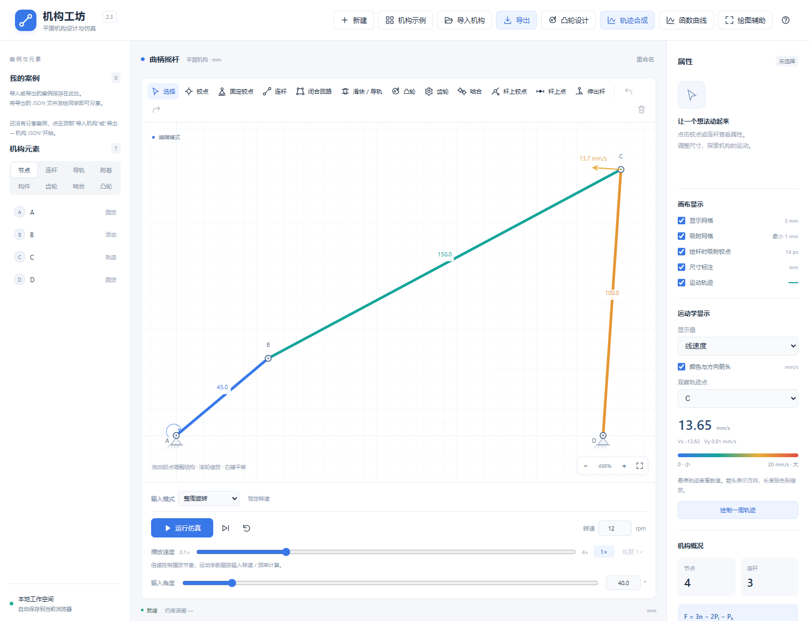
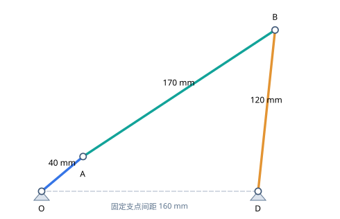
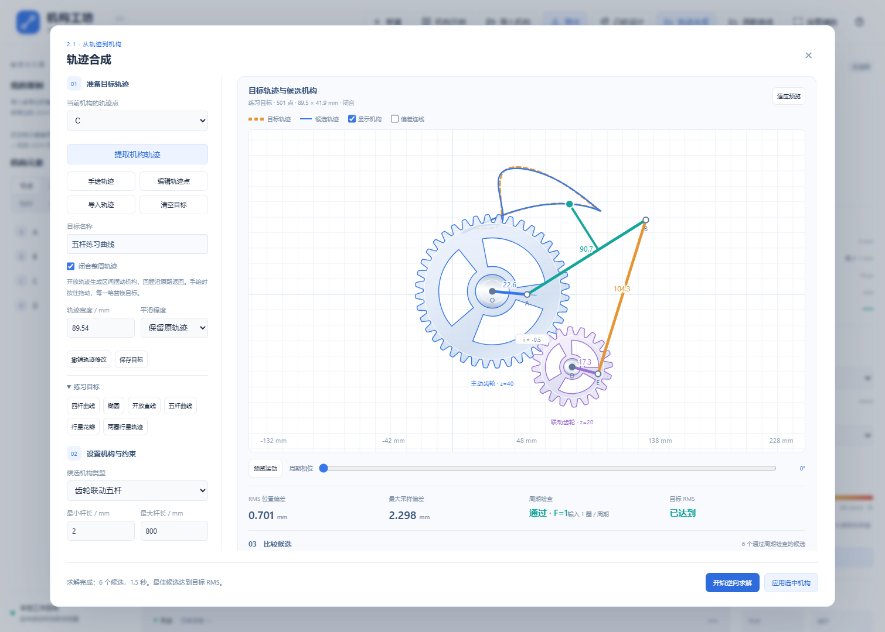
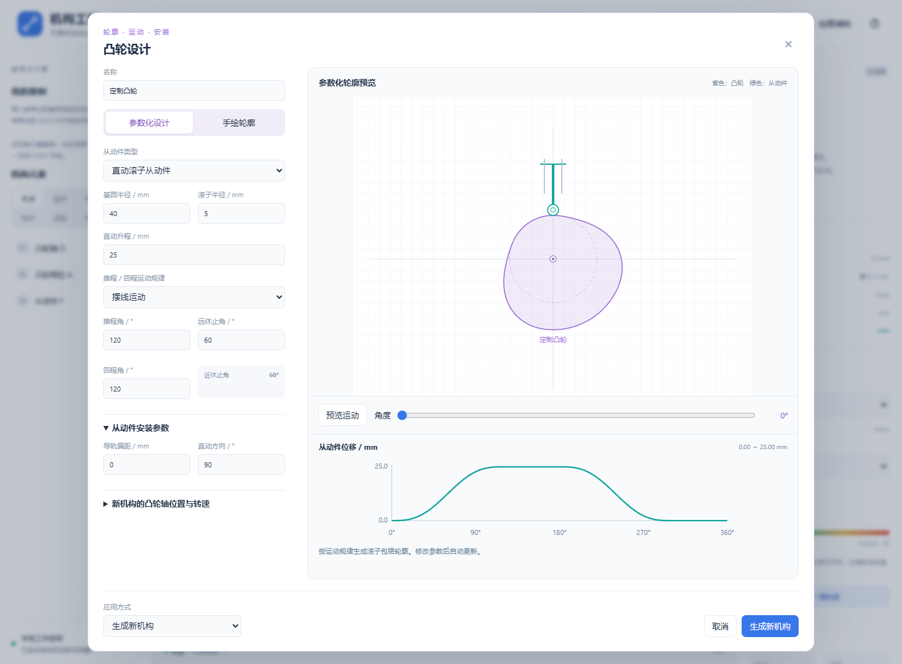
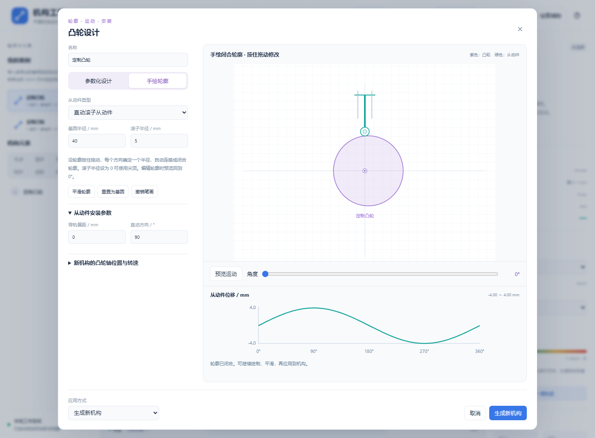
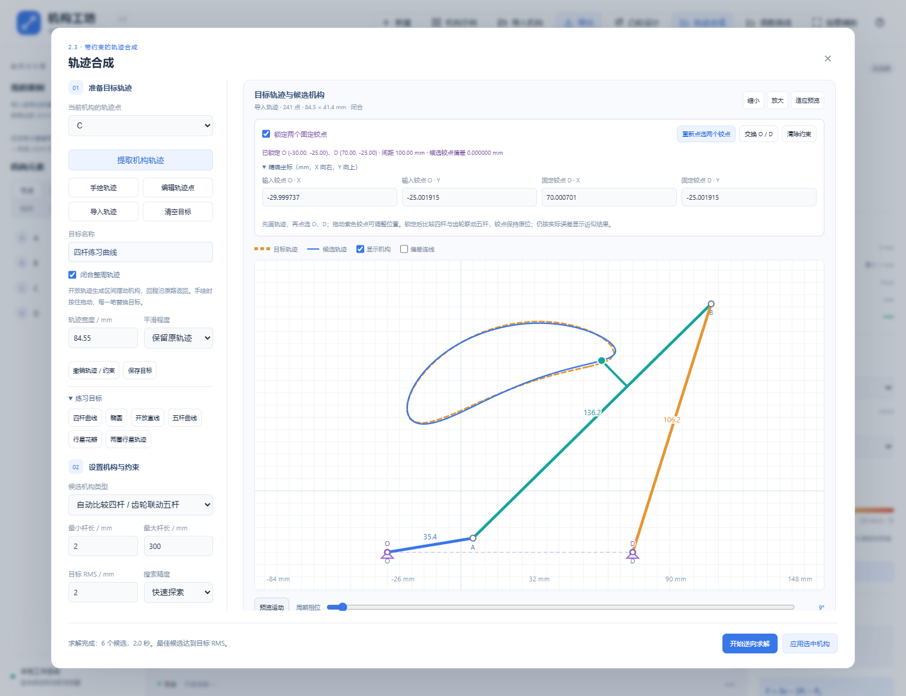
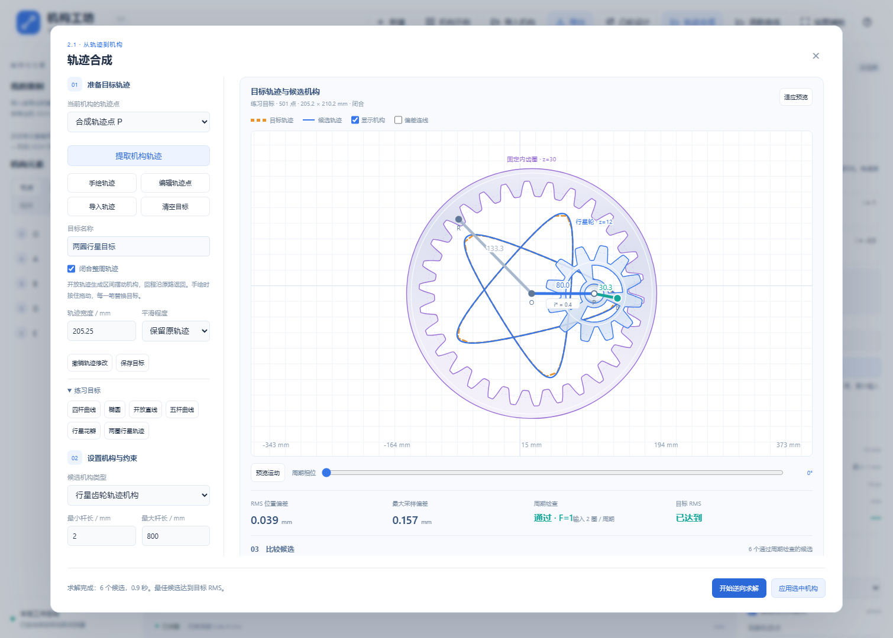
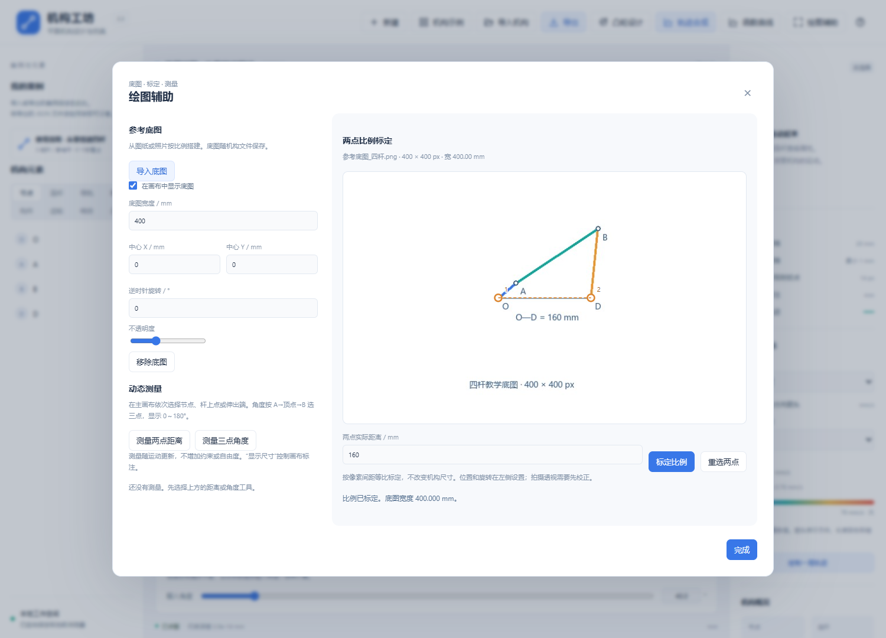
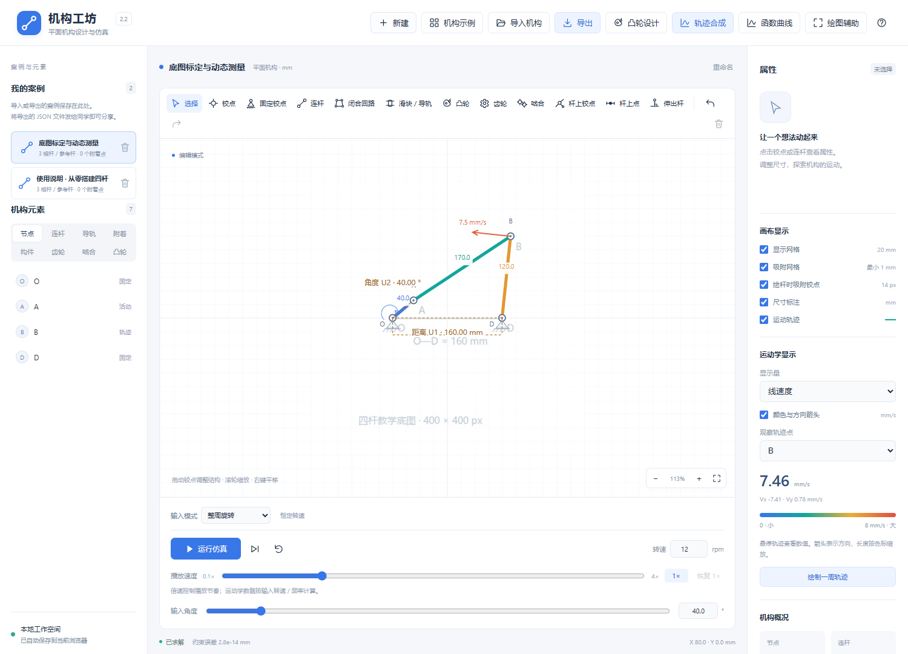

# 机构工坊使用说明书与案例教程

适用版本 2.3  适用对象 机构设计学习者与课堂演示者

本手册从打开软件开始，说明如何搭建连杆、导轨与齿轮机构，如何参数化或手绘凸轮，以及如何从目标轨迹逆向生成机构。每个教程都给出操作顺序、应看到的结果和可直接导入的案例文件。

软件采用 mm、°、r/min 和次/分。它用于平面几何与运动学设计；机构外观为教学简图。建议先完成一个四杆，再学习凸轮和轨迹合成。

## 1 打开软件并完成第一次仿真

### 1.1 文件与入口

解压完整发布包，进入“机构工坊”目录，双击“机构工坊_离线版.html”。推荐用 Edge 或 Chrome 打开，无需安装 Node.js，无需联网。也可以打开 index.html 使用分文件源码版。

完整目录中的 docs 保存说明书，examples 保存机构案例，examples/轨迹目标 保存逆向求解目标。程序顶部的“使用帮助”按钮可以打开网页版说明书和本 PDF。离线程序可单独拷贝；如果只携带一个 HTML 文件，请同时携带本手册，完整手册入口需要配套文档目录。

自动保存只保存在当前浏览器和本地文件位置。第一次打开显示曲柄摇杆；以后可能恢复上次设计。需要从标准起点开始时，点击“机构示例”并选择“曲柄摇杆”。

### 1.2 五分钟练习

1. 点击顶部“机构示例”，选择“曲柄摇杆”。有未保存修改时，按提示决定是否切换。
2. 点击“运行仿真”。观察曲柄整周转动，另一侧杆件往返摆动；再次点击按钮暂停。
3. 选择一个活动铰点，在属性中开启“记录运动轨迹”。点击“绘制一周轨迹”，查看完整运动周期的路径。
4. 在右侧选择观察点，查看线速度。切换“显示量”，分别查看线加速度、角速度及其单位。
5. 点击顶部“导出”，选择“机构 JSON”，把可继续编辑的结构保存到本地。

## 2 认识界面与绘图规则

### 2.1 五个主要区域

顶部包含新建、示例、凸轮设计、轨迹合成、函数曲线、导入、导出和帮助。左侧列出“我的案例”及节点、连杆、导轨、附着、构件、齿轮、啮合、凸轮等元素。中间是绘图区及工具栏。右侧显示选中元素的属性、运动量和机构自由度。画布下方控制播放、角度、输入转速和播放速度。

手机界面会缩短顶部按钮文字，属性区位于画布下方。独立设计窗口可以滚动；底部的求解或应用按钮保持可用。

### 2.2 坐标与鼠标操作

X 向右、Y 向上，角度从 X 轴起逆时针为正。网格会随缩放调整；勾选吸附网格后，以当前显示的网格间距吸附。靠近已有铰点时出现绿色圆环，表示会连接到该点。

“选择”工具用于选中和拖动。滚轮缩放，右键拖动平移画布，“适应画布”让机构及轨迹完整显示。点击连杆尺寸数字可以修改杆长，也可在右侧属性中输入。需要精确位置时，先创建节点并设置 X/Y，再连接杆件。

修改几何会重新确定受影响的杆长。拖动受导轨、齿轮或凸轮约束的元素时，程序按其约束处理；不要把受约束的输出点当作完全自由的点移动。

### 2.3 铰接与刚性连接

“闭合回路”默认生成独立杆件，顶点保持铰接。“整体刚性构件”用于把多根边合成为刚性板件，选中后可释放回独立杆件。三个独立杆围成的三角形本身不能变形；如果想获得运动，应检查机构是否有足够的活动连接和正确驱动。

“杆上点”是随母杆运动的观测点。“杆上铰点”是真实可连接节点，可从它引出新连杆。“伸出杆”与母杆刚性连接，其端点用于观测轨迹，不增加独立自由度。

## 3 案例一 从零搭建曲柄摇杆

### 3.1 准备四个节点

点击“新建”。用“铰点”工具创建 O、A、B、D 四个点，在“选择”工具下逐个修改名称和坐标。先完成所有坐标，再连接连杆，可减少互相约束带来的编辑影响。

| 节点 | X / mm | Y / mm | 状态 |
| --- | --- | --- | --- |
| O | -80 | 0 | 固定支点 |
| A | -49.3582 | 25.7115 | 活动铰点 |
| B | 92.5326 | 119.3438 | 活动铰点 |
| D | 80 | 0 | 固定支点 |

用“固定铰点”工具点击 O 和 D，把它们设为机架支点。该工具也可直接在空白处创建固定点。活动节点不要全部固定。

### 3.2 连杆与角度输入

1. 选择“连杆”，依次连接 O→A、A→B、D→B。每次吸附已有端点，避免产生位置接近但未连接的重复点。
2. 检查三根杆长约为 40、170、120 mm，固定支点间距为 160 mm。坐标保留小数时，尺寸可能有很小的舍入差异。
3. 选择 O→A 的杆件，在属性中点击“设为角度输入”。输入模式选“整周旋转”，转速设为 12 r/min。
4. 检查右侧自由度为 1，点击“运行仿真”。曲柄应能整周旋转，DB 应摆动；无法闭合时先核对坐标、连接关系和固定点。

也可以用“闭合回路”按 O、A、B、D、O 连续点击。这样会增加 OD 的机架边；默认各顶点仍为铰接。绘图中一次 Esc 取消草稿，第二次 Esc 回到选择工具。

### 3.3 记录轨迹并增加输出点

选中 B，开启记录轨迹。再选择“杆上点”，点击 AB 中部，可观察杆上另一位置的轨迹。需要从杆中部接新杆时，改用“杆上铰点”；需要观察杆外端点时，用“伸出杆”。点击“绘制一周轨迹”，再到“函数曲线”选择 X–Y 轨迹比较它们。

附赠文件“使用说明_从零搭建四杆.机构.json”采用上述尺寸，可直接导入核对。导入后可以修改曲柄长度，观察轨迹变化；原内置“曲柄摇杆”也是入门练习。

## 4 案例二 搭建曲柄滑块与移动副

### 4.1 水平曲柄滑块

新建三个节点：O=(0,0)，A=(34.6410,20)，B=(152.9626,0)。用固定铰点工具固定 O。先创建导轨，再连接杆件。

1. 选择“滑块 / 导轨”，安装类型选“机架上的导轨”，滑块连接方式选“铰接滑块”。
2. 点击 B，再在 B 右侧点击一个方向点，建立水平导轨。第二次点击定义方向，导轨上的滑块只有沿轨移动的自由度。
3. 用连杆连接 OA、AB，核对杆长为 40、120 mm。选择 OA 作为角度输入，整周旋转、12 r/min。
4. 运行仿真，B 应沿同一水平线往复移动。选中 B 记录轨迹，路径应为直线。

附赠文件“使用说明_从零搭建曲柄滑块.机构.json”采用上述尺寸；内置“曲柄滑块”也可用于观察导轨和输出速度。

### 4.2 导轨编辑

虚线导轨自动覆盖已计算的完整滑动行程，并留出端部余量。“最小显示长度”只改变绘图长度，不限制滑块行程。拖动滑块时，它沿既有导轨移动；选中导轨虚线或蓝色手柄，可平移整条导轨。

选择“活动杆上的导槽”时，先选择滑块节点，再选择安装母杆。导槽会随母杆一起运动。“固连”把滑块与某根杆锁定相对角度；需要允许杆件绕滑块转动时，应使用“铰接”。

“转动导杆”“移动导杆”“曲柄摇块”“双滑块”“双转块”示例分别演示不同移动副组合。修改前可先保存 JSON，修改后用撤销回到原结构。

## 5 齿轮传动与五杆机构

### 5.1 手动绘制齿轮传动

1. 选择“齿轮”工具，设置外齿轮、齿数和模数。先点击轴心，再点击固连的偏心点或方向点。轴心在空白处时默认固定，使用现有节点时保留其固定状态。
2. 再画第二只齿轮。选择“啮合”，依次点击两只齿轮，并选择外啮合或内啮合。两轮应采用同一模数。
3. 外啮合的中心距为两轮节圆半径之和，内啮合为半径之差。可以使用啮合属性中的对齐操作，让轴心满足中心距。
4. 选择输入齿轮的参考杆并设为角度输入。外啮合反向、内啮合同向；运行后在右侧“齿轮传动”查看转速和传动比。

参考杆用于定义齿轮的方位和固连关系，偏心距不等同于节圆半径。齿数或模数编辑可能调整轴心距离，轨迹也会随之改变。

### 5.2 为什么新增候选采用齿轮联动五杆

五杆由机架和四根活动杆组成，两根曲柄分别绕 O、D 转动。未联动时通常需要两个独立输入；本软件新增候选在两轴安装外啮合齿轮，使第二曲柄按确定齿比转动，形成单输入、F=1 的机构。

在本版中，最直接的做法是到“轨迹合成”选择“齿轮联动五杆”，求解并应用，或导入附赠“轨迹合成_齿轮联动五杆.机构.json”。随后可查看每根杆、两个固定支点、齿轮和啮合关系。不要删除同步啮合后仍把它当成单输入机构。

### 5.3 其他传动案例

外啮合、内啮合、复合定轴轮系、行星轮系和齿轮连杆扑翼机均可从顶部示例打开。阿基米德圆柱蜗杆示例采用 ZA 型平面简图，蜗杆与蜗轮按啮合中心距布置；头数和蜗轮齿数决定减速比。

## 6 案例三 参数化绘制凸轮

### 6.1 直动从动件

点击顶部“凸轮设计”打开独立窗口，选择“直动从动件”与“参数化设计”。可从内置“直动从动件平面凸轮机构”开始，再选择凸轮并编辑。

| 参数 | 教程值 | 作用 |
| --- | --- | --- |
| 基圆半径 | 40 mm | 基础轮廓尺寸 |
| 滚子半径 | 5 mm | 从动件接触滚子尺寸 |
| 升程 | 25 mm | 推程的输出位移 |
| 运动规律 | 摆线 | 推程及回程的位移规律 |
| 推程角 | 120° | 完成上升的输入区间 |
| 远休止角 | 60° | 保持最大升程 |
| 回程角 | 120° | 回到最低位置 |
| 近休止角 | 自动为 60° | 剩余输入区间 |
| 导轨方向与偏距 | 90°，0 mm | 垂直且通过轴心 |

1. 依次输入这些参数。右侧实时更新凸轮、滚子位置与输出曲线；四段角度之和为 360°。
2. 拖动角度滑条，检查上升、保持、下降、保持四段过程。点击“预览运动”连续查看。
3. 应用方式选“生成新机构”，设输入转速为 12 r/min，然后生成。该操作会切换主画布的机构。
4. 回到主画布运行仿真，选择滚子输出点记录轨迹，并打开函数曲线比较位移、速度和加速度。

摆线、3-4-5 多项式和简谐规律会产生不同的速度与加速度形状。先保持升程和阶段角相同，再切换规律，比较才有明确意义。

### 6.2 摆动从动件

打开“摆动从动件平面凸轮机构”，再进入凸轮设计。教程起点为基圆 40 mm、滚子 5 mm、摆角 24°、支点相对轴心 (75,0) mm、摆杆长 65 mm，阶段角与直动案例相同。

摆角控制输出摆动范围，支点位置和摆杆长度决定安装几何。接触分支决定摆杆处于哪一侧。每次修改后先预览整周期，确认滚子仍能接触轮廓，再更新凸轮。

### 6.3 新建 加入当前轴 与更新

“生成新机构”用于单独设计。“加入当前输入轴”适合已有固定输入轴的组合机构。“更新凸轮”用于重新编辑选中的凸轮，保留其输出节点引用。

拖动主画布中的凸轮轴心会带动整套安装。滚子、导轨偏距及摆杆支点应在凸轮设计窗口修改。明显根切、接触缺失、阶段角超限或无法闭合会被拒绝；依据提示调整滚子、基圆或安装位置。

## 7 案例四 手绘凸轮轮廓

### 7.1 绘制与修改

1. 打开凸轮设计，先选择直动或摆动从动件，并设置基本安装参数。
2. 切换到“手绘轮廓”。也可把已有参数化轮廓转为手绘，保留原轮廓再局部修改。
3. 沿紫色轮廓按住鼠标或触摸拖动，修改对应方向的半径。轮廓自动闭合，可以分段修改。
4. 使用平滑、撤销笔画或重置为基圆。先观察曲线，再用角度滑条或预览运动检查整个接触过程。
5. 生成或更新机构，运行仿真，再保存机构 JSON。重新导入后可继续编辑手绘轮廓。

手绘轮廓按绕轴各方向的单值半径保存，适合围绕轴心闭合的外轮廓。带凹洞、同方向多次穿过或不围绕轴心的任意涂鸦，不能直接作为这种凸轮轮廓。

### 7.2 附赠练习

导入“手绘偏心圆凸轮.机构.json”，运行并观察从动件位移。重开设计窗口，局部把轮廓向外推，再平滑；比较修改前后的输出曲线。该案例来自真实鼠标绘制后的轮廓，不以参数化升程替代手绘运动。

软件按实际轮廓接触计算运动。手绘加速度由平滑轮廓数值导数估计；如果加速度出现尖峰，应先检查轮廓是否有急转折，并使用适度平滑。

## 8 案例五 从现有轨迹逆向生成机构

### 8.1 提取目标

打开曲柄摇杆或“杆上点与伸出杆”示例，选择想作为目标的活动铰点、杆上点或伸出端。点击顶部“轨迹合成”，在“当前机构的轨迹点”选择该点，再点击“提取机构轨迹”。目标以橙色虚线显示。

程序提取的是完整运动周期；摆动来源只提取从最小角到最大角的一次行程。静止点或原机构无法完成周期时，先修复来源机构，再提取。

### 8.2 设置与比较

1. 选择“四杆机构”“曲柄滑块”“齿轮联动五杆”“行星齿轮轨迹机构”或“自动比较四类机构”。
2. 设置最小和最大杆长、目标 RMS。初次可用 2～800 mm、目标 2 mm、“快速探索”。结果不够好时再用标准或深入搜索。
3. 如果支点必须保持在指定位置，选四杆或五杆，点击预览区的“添加两个固定铰点”，依次点选输入铰点 O 与固定铰点 D，也可展开精确坐标输入。自动模式锁定两点后只比较这两类。
4. 点击“开始逆向求解”。进度包含评估次数和当前误差；可取消并保留已有候选。
5. 比较候选、尺寸、齿数和周期。拖动周期相位或播放预览，查看真实杆件运动；开启“偏差连线”查看采样匹配。

RMS 是位置偏差平方均值的平方根，目标 RMS 是达标标准；“最大采样偏差”是采样点中最大的距离。RMS 达标时，最大偏差仍可能大于目标 RMS。两者都应查看。

### 8.3 应用与继续修改

点击候选卡片，再点击“应用选中机构”。主画布得到真实单输入模型，可运行、改尺寸、画轨迹、分析运动量和导出。橙色虚线保留目标，彩色轨迹由主求解器重新计算。

修改杆长后，原目标不会自动变成新轨迹。保存的文件保留原始目标和搜索设置；重开合成窗口可继续求解，旧候选误差不会作为新误差继续显示。应用支持撤销 / 重做。

## 9 案例六 手绘目标与开放轨迹

### 9.1 手绘椭圆练习

1. 在轨迹合成中点击“清空目标”，再选择“手绘轨迹”。在预览区按住鼠标或触摸画一条椭圆，松开完成。
2. 一笔会替换旧目标。可用“撤销轨迹 / 约束”回退；选择“编辑轨迹点”，拖动控制点修改形状。
3. 勾选“闭合整周轨迹”，适度平滑。修改“轨迹宽度”可等比例缩放，纵向尺寸一起变化，单位为 mm。
4. 选择曲柄滑块或行星齿轮，开始求解并比较误差。对同一目标也可切换自动比较，查看不同结构的取舍。
5. 保存目标轨迹 JSON 和候选机构 JSON，分别用于再次求解和直接仿真。

附赠“轨迹合成_手绘椭圆曲柄滑块.机构.json”及其目标文件可直接复现这类练习。目标文件应在合成窗口导入，机构文件则用顶部“导入机构”。

### 9.2 开放轨迹

在练习目标中选择“开放直线”，或手绘一条不闭合的曲线并取消闭合勾选。程序拟合单次去程，并生成正弦往返输入；回程沿相同路径返回。附赠“轨迹合成_开放直线.机构.json”用于观察这个区别。

开放直线可能用较长杆件和较小摆动角近似。候选仍按实际偏差显示，目标形状不会被直接赋给输出节点。

### 9.3 搜索效果与约束

轨迹合成按弧长和点序拟合形状，不指定经过每个点的时间。当前只搜索四类参数化拓扑，复杂轨迹可能只能近似；深入搜索也不保证精确解或全局最优。

过紧杆长范围、错误闭合设置或不合适的固定支点，会限制可行解。先检查目标尺寸和约束，再增加搜索精度。齿轮候选搜索若干离散齿数组合，不是任意连续齿数比。

### 9.4 先画轨迹，再添加两个固定铰点

1. 手绘一条目标，或在合成窗口导入“轨迹合成_双固定铰点约束.轨迹.json”。添加铰点不会重画、移动或缩放已有轨迹。
2. 点击预览区的“添加两个固定铰点”，先放置驱动端 O，再放置另一端 D。完成后两个点自动锁定。先前选了曲柄滑块或行星齿轮时，程序切换为四杆 / 五杆自动比较。点选未完成时可按 Esc 或“取消点选”恢复原来的铰点。
3. 拖动紫色铰点改变安装位置。展开“精确坐标”，可填写 O=(-30,-25)、D=(70,-25) mm；间距为 100 mm。放不下时使用“缩小”或鼠标滚轮，之后用“适应预览”同时显示轨迹、铰点和候选。
4. 设置杆长 2～300 mm、目标 RMS 2 mm、快速探索。点击“开始逆向求解”，查看四杆与齿轮联动五杆候选、偏差和完整周期检查。约束栏显示候选铰点偏差，固定位置不会参与自由平移、旋转或缩放。
5. “交换 O / D”可换驱动端；“清除约束”恢复自由安装；“撤销轨迹 / 约束”可以回退这些修改。改变铰点、轨迹或杆长范围后，需要重新求解。
6. “保存目标”在求解前也会保存两铰点与杆长范围。重新导入可恢复约束；“导出选中机构”和主画布的机构 JSON 同时保存目标与合成设置。旧轨迹文件仍可导入；新增目标约束应使用 2.3 或更新版读取。

附赠“轨迹合成_双固定铰点约束.机构.json”可直接运行。目标文件位于 examples/轨迹目标；导入后先检查铰点坐标和杆长范围，再求解。任意手绘曲线和任意铰点不一定能同时满足：目标 RMS 是拟合标准，固定铰点位置是必须满足的约束。两个铰点重合、坐标空白或间距超出杆长范围时，会提示错误。

修改轨迹宽度只缩放目标，已经锁定的铰点仍保持世界坐标。要整体改变机构安装尺度，请同时调整铰点坐标。两固定铰点约束适用于四杆和齿轮联动五杆；曲柄滑块和行星齿轮仍可在清除约束后单独合成。

## 10 案例七 新增五杆与行星候选

### 10.1 五杆练习曲线

在“练习目标”中点“五杆曲线”，类型选“齿轮联动五杆”，快速探索后比较候选。卡片显示主动 / 联动齿数，尺寸顺序为机架、主动曲柄、联动曲柄、轨迹连杆、闭合连杆；悬停尺寸行可查看顺序。

应用后有四根活动杆和一对外啮合齿轮。输出 P 可以位于连杆上或伸出端，不一定是两杆交点 B。程序同时检查同步齿轮、杆长、两个装配分支和完整周期，要求 F=1。

附赠“轨迹合成_齿轮联动五杆.机构.json”。它适合练习曲柄联动、闭合连杆和目标对照；保存文件中的实际尺寸可能与另一次搜索不同。

### 10.2 行星花瓣与两圈轨迹

行星候选使用固定内齿圈、输入行星架和带偏心点的行星轮。行星轮边转动边绕轴心公转，偏心点产生椭圆、花瓣或多环路径。固定齿圈的方向参考杆属于机架，不是额外独立活动杆。

1. 选择“行星花瓣”目标，类型选“行星齿轮轨迹机构”，求解并比较偏心长度和齿数。
2. 再选择“两圈行星轨迹”。查看卡片上的“输入 2 圈 / 周期”，用周期相位滑条观察整个回位过程。
3. 应用后运行，或点击“绘制一周轨迹”；此时按保存的完整周期计算，包括所需的多圈输入。
4. 用函数曲线查看完整周期，并导出 CSV。半周期时的位置通常不同，周期结束才回到起点。

附赠“轨迹合成_行星花瓣.机构.json”和“轨迹合成_两圈行星轨迹.机构.json”，分别展示两种目标。不同候选可能需要 1、2 或 3 圈才能回位，窗口的周期相位 0～360°表示整个周期的进度，不等同于每种机构的单圈输入角。

杆长范围限制活动杆及四杆 / 五杆机架，不代表齿圈的最大外径。应用后可在主画布查看模数、齿数和实际节圆尺寸。

## 11 轨迹 曲线与文件分享

### 11.1 运动量与播放

观察点可选铰点、杆上点或伸出端。线速度和线加速度单位为 mm/s、mm/s²；角速度属于参考杆，单位 rad/s，逆时针为正。共享铰点的角速度需要明确参考杆。

播放速度 0.1～4 倍只改变动画节奏。曲线、速度和加速度仍按输入转速或摆动频率计算，负转速决定方向。输入为零时不会自动产生物理运动量；单步用于查看位形。

### 11.2 函数曲线

点击“函数曲线”，勾选最多六个节点。快速对比“X–Y 轨迹”保持两个方向等比例；“分速度 Vx / Vy”同时显示有符号分量，Vx 实线、Vy 虚线。横轴可选角度、时间或 X 坐标，纵轴可选择对应位置或运动量。

悬停查看同一驱动位形下各点数据。摆动有去程和回程，多周齿轮保留完整周期；不可达或奇异区间会断开。CSV 保存采样数值，PDF 保存图和图例。

### 11.3 保存与导入

顶部“导出→机构 JSON”或 Ctrl+S 保存可编辑结构和显示设置；顶部“导入机构”读取文件。2.3 保存 v9 机构，兼容读取 v1～v8；五杆和行星合成需要 2.1 或更新版。带底图或动态测量的文件附带案例设置 v2，需要 2.2 或更新版；普通案例仍使用设置 v1。自动保存和“我的案例”是浏览器本地记录，跨电脑请使用 JSON。

合成窗口的“目标轨迹”使用独立轨迹格式，包含 mm 坐标和闭合状态；“导出选中机构”保存可运行机构。“导出偏差数据”保存目标 / 候选采样位置与距离。“导出对比 PDF”包含目标、候选、误差和齿数周期说明。

主画布 PDF 包含当前已记录且开启的轨迹。要导出完整周期，请先绘制轨迹。PDF 是图像版教学输出，按页面范围适配，不是 1:1 制造图。

## 12 附赠案例导航

### 12.1 推荐学习顺序

先练“从零搭建四杆”和“从零搭建曲柄滑块”，再看杆上点与伸出杆、活动导轨、齿轮传动。然后完成直动参数化凸轮、摆动凸轮与手绘凸轮。最后练习已有轨迹提取、手绘椭圆、五杆曲线和多圈行星合成。

内置示例共 22 个；examples 根目录共 36 份可导入机构，另有 7 份目标轨迹。下面按学习目的归类，文件名以发布包中的实际文件为准。

| 案例 | 学习重点 |
| --- | --- |
| 使用说明_从零搭建四杆 | 本手册的四点坐标与三根活动杆 |
| 使用说明_从零搭建曲柄滑块 | 水平导轨与往复直线输出 |
| 曲柄摇杆 双曲柄 双摇杆 | 四杆分类与整周 / 区间运动 |
| 曲柄滑块 转动导杆 移动导杆 曲柄摇块 | 转动副与移动副组合 |
| 正弦 双滑块 双转块 | 不同导槽及输入连接方式 |
| 位移缩放 多杆轨迹 Jansen 行走机构 | 输出比例、多杆闭合与足端轨迹 |
| 杆上点与伸出杆 杆上铰点与分支滑块 | 观测点、真实连接点、刚性伸出端 |
| 外啮合 内啮合 复合定轴轮系 | 反向、同向与多级传动比 |
| 行星轮系 齿轮连杆扑翼机 ZA 蜗杆 | 活动轮系、偏心联动和减速 |
| 直动凸轮 摆动凸轮 手绘偏心圆凸轮 | 参数化接触与实际手绘轮廓 |
| 轨迹合成_四杆拟合 | 目标对照与真实连杆生成 |
| 轨迹合成_手绘椭圆曲柄滑块 | 手绘、平滑和目标保存 |
| 轨迹合成_双固定铰点约束 | 指定安装位置、求解与约束文件往返 |
| 轨迹合成_开放直线 | 去程拟合与原路回程 |
| 轨迹合成_齿轮联动五杆 | 两曲柄同步与闭合连杆 |
| 轨迹合成_行星花瓣 | 固定内齿圈与偏心输出 |
| 轨迹合成_两圈行星轨迹 | 完整周期大于一个输入周 |

### 12.2 一次完整案例练习

任选一份机构文件导入，先运行并观察，再选择输出点绘制轨迹。保存原始 JSON，修改一个明确参数，重新绘制轨迹并导出曲线 CSV。最后撤销修改，确认结构恢复。一次只改一类参数，更容易判断变化来自哪里。

目标文件位于 examples/轨迹目标。导入到合成窗口后，可比较不同候选类型；原机构文件则直接导入主画布。两个文件的用途不同，扩展名也分别为“轨迹.json”和“机构.json”。

## 13 常见问题与快捷键

### 13.1 运行不了或求解不成功

机构自由度为 0：检查是否固定了活动节点、合成了不需要的刚体，或误把回路当作整体构件。自由度大于 1：检查连接是否吸附到同一节点、是否缺杆或导轨，五杆是否保留同步啮合。设置输入后仍不动：检查转速非零及输入杆正确。

只有部分角度可以闭合：检查尺寸与装配分支。需要摇动的输入应选区间摆动并设置可达范围；不能因为想整周动画而强行把不可达机构切换为回转。

凸轮提示接触或曲率问题：先减少滚子半径、调整基圆和安装位置，或平滑手绘急转折。阶段角相加不能超过 360°，剩余角度才是近休止。

合成误差较大：检查单位、目标尺寸、闭合状态和支点。先放宽不必要的约束，换候选类型，再提高搜索精度。没有候选时，不应把未通过完整周期的方案当作成功机构。

### 13.2 保存与显示问题

轨迹没有显示：开启观察点记录轨迹及“运动轨迹”显示，再绘制周期。修改结构后应重新计算。已保存 JSON 能恢复结构，PDF 和 CSV 不能反向恢复整个可编辑机构。

新文件旧版打不开：使用 2.3 或更新版，避免丢失新合成设置。浏览器本地记录丢失时，用本地 JSON 重新导入；不要只依赖自动保存。

### 13.3 常用快捷键

| 快捷键 | 操作 |
| --- | --- |
| V P G L | 选择 铰点 固定铰点 连杆 |
| C S | 闭合回路 滑块与导轨 |
| R M | 齿轮 啮合 |
| J T E | 杆上铰点 杆上点 伸出杆 |
| Enter | 完成闭合回路草稿 |
| Esc 两次 | 取消草稿后回到选择 |
| Ctrl+Z Ctrl+Y | 撤销 重做 |
| Ctrl+S | 导出机构 JSON |

在输入框中编辑文字或数字时，先确认输入或退出，再使用绘图快捷键。

### 13.4 使用边界

本软件为单输入平面几何与运动学工具，不计算受力、弹簧、材料强度、碰撞或制造公差。凸轮仿真假定持续接触；齿轮和蜗杆外观为教学示意。合成误差和周期通过状态来自离散采样，不是连续最大误差或机构强度证明。

需要制造或工程应用时，应另行完成压力角、干涉、接触、承载及三维结构设计。日常练习中，先确认连接和运动，再讨论结构能否加工和承载。

## 14 案例八 从底图复建到 CAD 导出

### 14.1 导入参考图并标定毫米比例

2.2 新增顶部“绘图辅助”（手机显示“辅助”）。底图适合用已有图纸或照片作为搭建参照，测量用于观察尺寸关系。两者不作为机构运动约束。

1. 打开“绘图辅助”，点“导入底图”。支持不超过 8 MB 的 PNG、JPEG 或 WebP；图像会等比缩小到最长边 1920 px，并作为 JPEG 内嵌保存。
2. 在右侧底图预览中点击一段已知长度的两个端点。输入“两点实际距离 / mm”，点击“标定比例”。底图宽度按像素间距等比计算，已有机构尺寸不改变。
3. 设置底图中心 X/Y 和逆时针旋转角。不透明度可调低，便于识别上层连杆；取消显示可暂时隐藏，移除可通过撤销恢复。
4. 回主画布，在图中的支点和铰点上创建节点，再连接杆件、添加导轨并设置输入。需要准确定位时先关掉网格吸附，在属性中检查坐标。
5. 用“导出 → 机构 JSON”保存。底图、标定宽度、位置与透明度随文件携带；原图片文件可以不随机构发送。浏览器本地自动保存也保留底图。

标定只恢复一项比例，不能自动修正拍摄透视或畸变；照片应先校正。预览选点越精确、已知参考线越长，比例越容易准确。底图始终作为固定背景，不会随活动杆旋转。

### 14.2 教学底图练习

发布包有 examples/参考底图_四杆.png，为 400 × 400 px 的平面示意，O—D 为 160 mm。可先导入本书“使用说明_从零搭建四杆.机构.json”，再导入底图。预览中选择 O、D，实际距离填 160 mm；标定后的图片宽度应接近 400 mm，中心保持 (0,0)、旋转 0°，机构应覆盖相应的底图节点。

也可新建空白机构，从该底图开始复建。本例仍需要分别固定 O、D，连接 OA、AB、DB 并给 OA 设置输入；底图不会自动识别节点或替你建立连接。

### 14.3 测量距离与角度

1. 在“绘图辅助”中点“测量两点距离”，回到主画布后依次点击两个现有节点。可选活动铰点、固定铰点、杆上点或伸出端；同一个点不能重复选择。
2. 点“测量三点角度”，按 A、顶点、B 的顺序选三点。角度显示两条射线间的 0～180° 小角，不是累计转角；两条射线中有一条长度为零时显示“未定义”。
3. 选择 O、D 测距离，应约为 160 mm。选择 A、O、D 测角，在本书四杆的 40° 起始姿态应约为 40°。修改输入角度或播放，角度标注会随位形更新，O—D 距离保持不变。
4. 再开“绘图辅助”，可隐藏或删除测量。画布“尺寸标注”控制所有测量是否显示。选择过程中一次 Esc 取消已选点，第二次 Esc 回到选择工具。

测量不会锁定长度或角度，不增加自由度；改变机构仍使用原有节点、杆长和输入属性。关联点被删除时测量会清理，撤销可恢复。底图与测量的修改、切换机构和保存重开均支持恢复。

附赠“绘图辅助_底图标定与动态测量.机构.json”已保存标定底图、O—D 距离和 A—O—D 角度，可直接导入、运行并导出 PDF。带绘图辅助的文件仍为机构 v9，但案例设置升级为 v2，需要软件 2.2 或更新版；普通文件继续使用案例设置 v1。

### 14.4 导出毫米几何到 CAD

先暂停到需要的姿态。如需运动路径，先绘制完整周期轨迹并保持“运动轨迹”显示开启。点击“导出 → CAD 几何 DXF”，导出的世界坐标采用毫米，与画布缩放、平移及 PDF 的页面比例无关。

| 图层 | 内容 |
| --- | --- |
| LINKS / JOINTS | 当前杆件中心线、观测点中心标记 |
| GUIDES | 固定与活动导轨 |
| CAM_PROFILE | 当前姿态的闭合凸轮轮廓与滚子圆 |
| GEAR_PITCH | 齿轮节圆示意 |
| TRACES | 已开启的记录轨迹及合成目标 |
| MEASUREMENTS / LABELS | 可见测量的线与数值、节点编号和杆长 |

发布包中 output/教学四杆_毫米几何_2.2.dxf 可用于检查，O—D 坐标距离应为 160 mm。文件为 R2000 DXF，可在兼容 CAD 中打开并继续编辑线、圆和多段线。标签使用编号和英文单位，避免依赖中文 CAD 字体。底图不写入 DXF；隐藏的测量和关闭的轨迹也不写入。

DXF 保存静态几何，不能替代机构 JSON。齿轮为节圆，杆件为中心线与点标记，凸轮为闭合采样多段线；实际加工前需在 CAD 中完成制造细节设计与校核。
